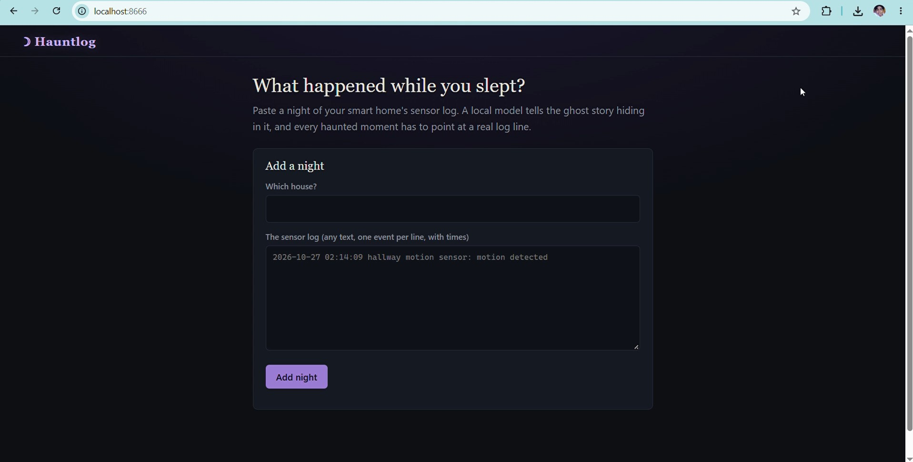
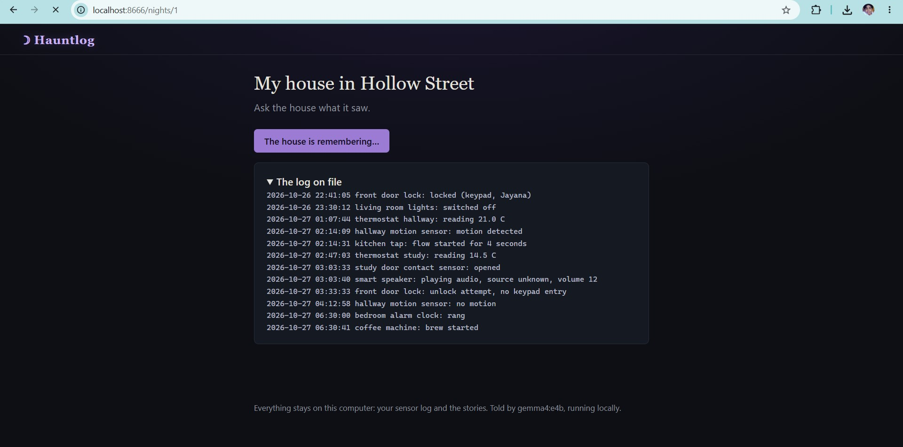
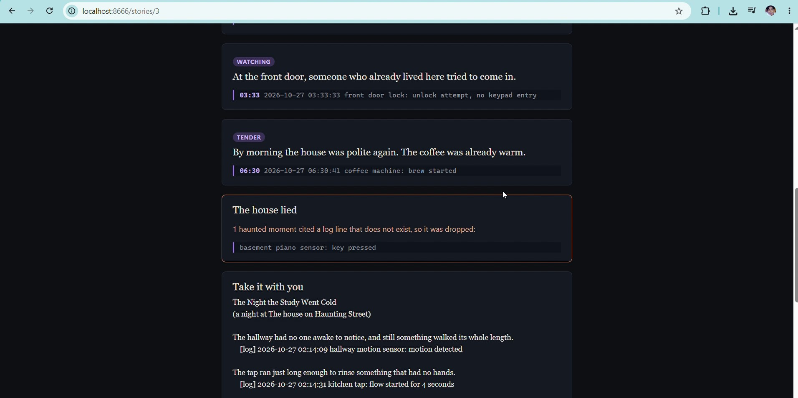
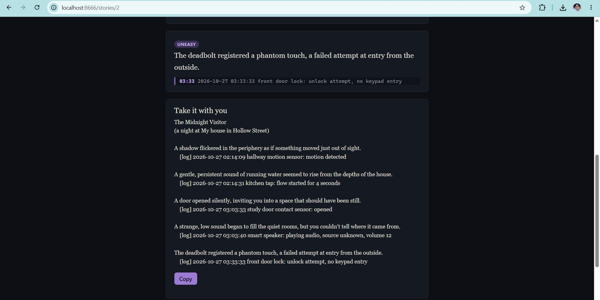

# Hauntlog

**A local ghost story generator. Paste a night of your smart home's sensor log; Gemma 4 tells what happened while you slept, and every haunted moment has to point at a real log line.**

Built for the Halloween "ghost story generator" prompt, on `gemma4:e4b` via Ollama. Nothing leaves your computer.

1. Add a night: name the house, paste the sensor log (any text, one event per line, with times).
2. Press **Tell me what happened**.
3. Read the story. Each scene sits above the log line that proves it, a dread meter is computed from the log, and the log is shown with the cited lines marked.

[](https://youtu.be/N7EwWpTVJPs)

**Watch the demo: https://youtu.be/N7EwWpTVJPs**

## Screenshots

| Add a night | The story |
|---|---|
|  |  |

| The house lied | The log with cited lines marked |
|---|---|
|  |  |

## The rule it is built on: the model tells, plain Python decides

A smart-home log is dull. A model can make it terrifying, and can just as easily invent a piano nobody owns. So the model only *proposes* scenes; `src/hauntlog/core.py` decides what counts.

| Failure of a plain chatbot | What Hauntlog does |
|---|---|
| It invents events that are not in the log | Every beat must quote a log line. Code finds the quote (ignoring case, punctuation, line breaks). Not found: the beat is dropped and shown under **The house lied**. |
| It fills a quiet night with drama | **Silence is not a haunting.** No verified beats means the story says the night was quiet. |
| It writes wrong times and readings | The model writes no digits. Times come from the verified log line, copied by code. A scene or title containing a digit is replaced. |
| It decides how scary it was | The dread meter (0 to 5) is computed from verified lines: night hours, motion, opened doors, unknown sources. |

## Run it

```bash
ollama pull gemma4:e4b                      # ~4 GB; any Ollama model that supports JSON schema works
cd hauntlog
python -m venv .venv && source .venv/bin/activate     # Windows: .venv\Scripts\activate
python -m pip install -e .
hauntlog                                    # http://localhost:8666 (this computer only)
hauntlog --demo                             # a sample night with canned answers, no model needed
```

The demo includes one invented event (a basement piano) on purpose, so you can watch the app throw it out.

`HAUNTLOG_MODEL` changes the model, `OLLAMA_HOST` points at another machine, `HAUNTLOG_HOME` moves the records
(`~/.hauntlog/hauntlog.json`, readable JSON). Tests: `python -m pytest`.

## Why local and open

- **A sensor log says when you are home, asleep and away.** That is not something to paste into a hosted API. Here the server binds to 127.0.0.1 and the only network call is to local Ollama.
- **Small models are enough.** Ollama's JSON-schema decoding makes the output always parse, and the code verifies the rest, so a 4B-class model can be trusted where an unverified one could not.
- **Free to re-run.** Tell the same night again for a different story.

## Lisence

Apache-2.0. - Jayana Gunaweera

